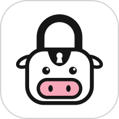

<div align="center">

<h1>
  
  Contributing to KuhKey
</h1>

[Issues](#issues) · [Branches](#branches) · [Commits & PRs](#commits-and-pull-requests) · [Definition of Done](#definition-of-done) · [Code Style](#code-style)

</div>


## Issues

- Use the **Feature / Task** or **Bug report** template.
- Title: `<area>: <short description>`, with area one of `core`, `cli`, `ui`, `desktop`, `ext`, `server`, `tui`.
- Set the priority and sprint on the project board.

## Branches

```
<type>/<issue-number>-<short-description>
```

e.g. `feat/55-username-generator`, `fix/41-clipboard-linux`

- `type` is one of `feat`, `fix`, `docs`, `refactor`, `test`, `chore`.
- Lowercase, words separated by hyphens.
- One branch per issue, branched off `main`.
- Branches are **not** deleted after merging. They stay as a history of our work.

## Commits and Pull Requests

- No pull request without an issue. Link it with `Closes #123` in the PR description.
- PR titles and commit messages follow [Conventional Commits](https://www.conventionalcommits.org):

| Prefix      | Use for                                  |
| ----------- | ---------------------------------------- |
| `feat:`     | New functionality                        |
| `fix:`      | Bug fixes                                |
| `docs:`     | Documentation only                       |
| `refactor:` | Code changes without behavior changes    |
| `test:`     | Adding or changing tests                 |
| `chore:`    | Tooling, CI, dependencies, housekeeping  |

- At least **one approving review** is required before merging.

The board updates automatically:

| Event                   | Status        |
| ----------------------- | ------------- |
| PR linked to the issue  | → In Review   |
| Changes requested       | → In Progress |
| PR merged               | → Done        |

## Code Style

### Avoid `unwrap()` and `expect()`

We prefer handling errors over unwrapping:

```rust
// avoid
let vault = load_vault(path).unwrap();

// match
match load_vault(path) {
    Ok(vault) => open(vault),
    Err(e) => eprintln!("could not load vault: {e}"),
}

// if let / let-else
if let Some(entry) = vault.get("github") {
    copy(entry);
}

let Some(entry) = vault.get("github") else {
    return Err(Error::NotFound);
};

// ? operator: pass the error to the caller
fn read_entry(path: &Path) -> Result<Entry, Error> {
    let vault = load_vault(path)?;
    // ...
}
```

The same applies to `Option`.

If an `unwrap()` or `expect()` really can't fail, leave a comment that explains why it's safe:

```rust
// safe: the regex is a constant and covered by a unit test
let re = Regex::new(r"^[a-z0-9_-]+$").unwrap();
```

### Generics

Put trait bounds in a `where` clause:

```rust
trait Area {
    fn area(&self) -> f32;
}

fn print_area<T>(shape: &T)
where
    T: Area,
{
    println!("The area of the shape is: {}", shape.area());
}
```